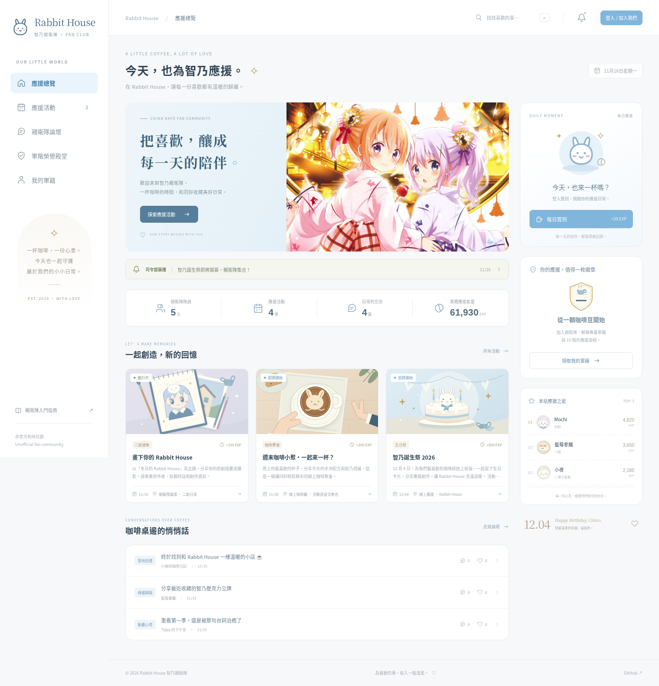

# Rabbit House · 智乃親衛隊

以 Flask 製作的香風智乃粉絲應援網站，結合咖啡廳社群與中華民國陸軍 19 階晉升制度。介面使用繁體中文，提供訪客瀏覽、會員活動與論壇互動，以及管理員總司令部。

這是非官方粉絲作品；網站的活動、會員與貼文範例均為示範資料，與原作官方或軍方無關。活動、頭像與軍階 SVG 為原創向量繪圖；首頁替換圖片的來源與說明詳見 `static/art/CREDITS.md`。

## 網站預覽

首頁採用粉藍、奶油白與拿鐵色；軍階及司令部加入金色與橄欖綠。以下為實際 Flask 資料及網頁渲染的截圖（含示範資料）：



| 手機版 | 會員首頁 |
| --- | --- |
| [查看手機版截圖](docs/preview/home-mobile.png) | [查看會員版截圖](docs/preview/member-desktop.png) |
| [活動詳情與報名](docs/preview/event-detail.png) | [19 階軍階徽章](docs/preview/ranks-desktop.png) |
| [管理後台總覽](docs/preview/admin-desktop.png) | [管理員人事命令](docs/preview/admin-members.png) |

目前提供可自行啟動的 Flask 專案與畫面截圖，尚未部署公開的 Python 主機。GitHub 儲存庫網址是程式碼頁面。

## 本機啟動

需要 Python 3.11 或更新版本。

```bash
python -m venv .venv
source .venv/bin/activate
pip install -r requirements.txt
export SECRET_KEY='local-preview-change-me'
export DEMO_MODE=true
export COOKIE_SECURE=false
python app.py
```

開啟 `http://127.0.0.1:5000`。Windows PowerShell 的環境啟用指令為 `.venv\Scripts\Activate.ps1`，環境變數使用 `$env:DEMO_MODE="true"` 形式設定。

示範模式會建立以下帳號，僅供本機預覽：

| 身分 | 帳號 | 密碼 |
| --- | --- | --- |
| 會員 | `chino` | `Chino2026!` |
| 管理員 | `commander` | `Rabbit2026!` |

註冊新會員後需要驗證 Email。示範模式會提供本機驗證連結；正式環境必須配置 SMTP，驗證連結才會透過信件寄送。`.env.example` 只提供變數範本，程式不會自動讀取 `.env`；請在 shell、Docker Compose 或部署平台的環境設定載入變數。

## 可操作功能

- **會員軍籍**：註冊、登入、Email 驗證、記住登入、頭像與暱稱、軍階徽章、EXP 晉升進度、每日簽到。
- **軍階制度**：19 個階級，從二等兵至一級上將；普通會員以 EXP 晉升，一級上將保留為管理員的榮譽階級。
- **活動中心**：活動詳情、分類與狀態篩選、報名與取消、階級門檻及名額限制。
- **親衛隊論壇**：分類討論、發文、留言、按讚，以及管理員置頂公告與鎖定討論串。
- **總司令部**：活動管理、出席積分發放、會員 EXP 與封鎖管理、論壇公告與管理紀錄。

每日簽到 +20 EXP；活動獎勵由管理員確認出席後發放。

EXP 採資料庫交易與唯一紀錄限制，避免同一天重複簽到、重複領取活動獎勵或反覆按讚刷分。論壇發文每篇 +5（每日上限 20），回覆每則 +2（每日上限 20），獲得其他會員按讚每次 +1（每日上限 10）。達到每日上限後仍可正常參與討論。每日簽到以 `Asia/Taipei` 的日期計算。

## 正式環境設定

正式環境請使用獨立新資料庫，關閉 `DEMO_MODE`，設定高強度 `SECRET_KEY`，並以 HTTPS 部署。不要把示範帳號或本機預覽資料庫上傳到正式服務。

| 變數 | 用途 |
| --- | --- |
| `SECRET_KEY` | Flask Session 與 Email 驗證的簽章金鑰，必須由部署環境保管 |
| `DATABASE_PATH` | SQLite 資料庫路徑；預設 `instance/chino.sqlite3` |
| `DEMO_MODE` | 正式環境設為 `false` |
| `COOKIE_SECURE` | HTTPS 正式環境設為 `true`，控制 Session 的 Secure Cookie |
| `PUBLIC_BASE_URL` | 正式環境必要；寄送驗證連結時使用的網站公開 HTTPS 網址 |
| `SMTP_HOST`、`SMTP_PORT` | 郵件伺服器與連接埠（預設 587） |
| `SMTP_USERNAME`、`SMTP_PASSWORD` | SMTP 登入資訊 |
| `SMTP_FROM` | 驗證信寄件者 |
| `SMTP_TLS` | 預設 `true`，使用 STARTTLS |
| `PORT` | 本機 Flask 伺服器連接埠（預設 5000） |

`COOKIE_SECURE` 對應 Flask 的 `SESSION_COOKIE_SECURE` 設定。Session 另啟用 HttpOnly 與 SameSite；所有資料變更 API 需要 CSRF Token，管理 API 在伺服器端驗證身分與權限，密碼使用 Werkzeug 雜湊。

使用 Gunicorn 啟動正式服務：

```bash
export DEMO_MODE=false
export COOKIE_SECURE=true
# 先在部署平台設定其餘環境變數
.venv/bin/gunicorn --bind 0.0.0.0:5000 --workers 1 'app:create_app()'
```

初次建立管理員，請在相同環境與資料庫設定下執行：

```bash
.venv/bin/flask --app app create-admin --username your-admin --email admin@example.com
```

指令會互動式詢問並確認密碼；正式管理員密碼至少需要 12 個字元。啟動時會自動建立資料表；也可以使用 `flask --app app init-db` 補建資料表，既有資料不會被清除。

請將資料庫所在的 `instance/` 或自訂 `DATABASE_PATH` 掛載至持久儲存空間並定期備份。預設使用 SQLite；尚未接入 MySQL / PostgreSQL。SQLite 適合目前的單機版本；多實例或大量併發部署前，需要先完成資料庫遷移及對應測試。

## Docker

複製 `.env.example` 為 `.env`，填入正式環境變數後執行：

```bash
docker compose up --build -d
docker compose exec web flask --app app create-admin --username your-admin --email admin@example.com
```

Compose 會把 SQLite 保存在具名 volume `chino-data`。網站容器監聽本機 5000 埠，對外服務請接上支援 HTTPS 的反向代理。若僅需 HTTP 本機測試，請把 `.env` 的 `COOKIE_SECURE` 改為 `false`。

## 測試

```bash
.venv/bin/pytest -q
```

測試會使用暫存 SQLite 資料庫，不會修改實際資料庫，涵蓋權限、CSRF、註冊驗證、每日簽到、軍階、活動報名與積分冪等性，以及論壇與封鎖行為。

此版本已通過 **21 項後端整合測試**與 **10 組 Chromium 使用流程檢查**。可選擇安裝 Playwright，重新執行實際瀏覽器檢查：

```bash
source .venv/bin/activate
pip install playwright
playwright install chromium
python tests/browser_smoke.py
```

檢查會啟動範圍限定於本機的暫存 Werkzeug 伺服器，使用獨立暫存資料庫，完成後關閉；不會連接正式服務或修改正式資料。涵蓋手機導覽、會員登入與簽到、活動報名、論壇與 HTML 跳脫、19 階與響應式版面、軍籍編輯、管理後台及註冊驗證。程式會優先使用 `CHROMIUM_PATH` 指定的瀏覽器，其次使用系統的 `chromium`，否則使用 Playwright 安裝的 Chromium。

截圖預設寫入 `work/preview/`，可透過 `PREVIEW_OUTPUT` 改變位置；檢查結果寫入 `work/browser-results.json`。這些執行產物不會加入版本控制。本次環境的預覽轉發 relay 無法使用，因此以實際瀏覽器截圖提供畫面預覽，沒有建立可外連的即時分享網址。

## 專案結構

```text
app.py             Flask 應用程式、JSON API 與權限檢查
schema.sql         關聯資料表與資料完整性限制
static/            樣式、互動程式與原創插圖
templates/         網站入口模板
tests/             整合測試
Dockerfile         正式環境映像
compose.yaml       單機部署與持久化資料卷
```

本專案不包含真實會員名單、SMTP 憑證或正式資料庫。GitHub Pages 無法執行 Flask；請使用可執行 Python / Docker 並提供持久儲存空間的主機。
